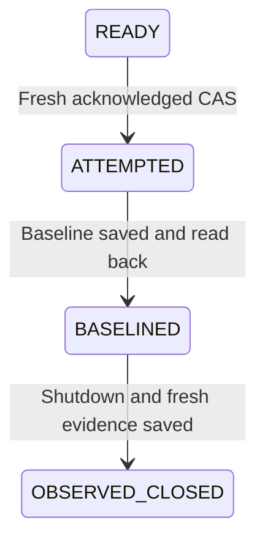

# Durable credential baseline in managed maintenance

17 October 2026. Managed maintenance protocol4 saves the credential-read baseline
in the independent control record before shutting services, database writers or
storage keys. It retains the later read-refusal observation in that record too.
This integrates the existing [read-proof component](supabase-credential-read-proof.md).

## Scope and phases

The plan binds installation/source/epoch, Render/database/storage registries,
credential-read policy and the complete probe registry digest. The probe must
match the storage project's installation, project reference, retained capture
key ID and every reviewed modern secret writer-key ID. Publishable keys can still
be revoked by storage control; they are outside this modern-secret read proof.

An externally authorised READY record must name the exact protocol4 plan.
Protocol1–3 plans refuse before acquisition or dispatch. No code initialises,
resets, expires, takes over, reopens or advances an epoch automatically.

1. Acquire the existing independent one-attempt guard.
2. Read the approved private synthetic canary with all probe credentials and
   bracketing controls. Validate the returned baseline against the exact registry.
3. CAS the baseline body and its original SHA into the control head as BASELINED.
   Require the existing exact account/key/version/ETag/body readback. Validate the
   stored artifact again. An unknown response stops here; it never permits later
   shutdown merely because the write may have committed.
4. Only that acknowledged caller suspends/drains Render, closes/drains database
   writers, invalidates their passwords and closes the named storage key paths.
5. Use the retained baseline for fresh credential read refusals and healthy
   controls. Read current service/database/storage state again.
6. CAS OBSERVED_CLOSED with the original baseline, complete refusal artifact and
   matching observation digest, against the BASELINED revision. No automatic
   retry or compensation follows an uncertain result.

The independent envelope remains format1, with new BASELINED phase and optional
`readBaseline`/`readObservation` artifacts. Optional fields preserve readable older
evidence; new completed records require a coherent pair. Artifact integrity checks
do not themselves authenticate a publisher. Actual independent IAM/key custody,
source-image provenance and protection from privileged replay remain required.

## Receipt integrity and bounds

Shared closed schemas validate baseline and observation formats, canonical JSON,
full body hashes and exact size. Baseline configuration/canary/count must match
the current probe. Its maintenance binding names the exact attempt UUID, source
revision, epoch and plan digest. The independent head checks attempt/epoch/plan;
the coordinator also checks the actual source revision before any shutdown or
fresh inspection. Recomputing artifact hashes cannot transfer an old baseline
to a different operation. Reports require unique ordered tested UUIDs, matching core
observation digest and explicit read-only scope/false broader flags. Stored pairs
must agree on baseline SHA, configuration, count and chronological ordering;
recorded readProofDigest must match the report. Inspection also checks recorded
UUIDs against the actual supplied registry, not merely a recomputed hash.

The baseline contains no raw credential, object bytes or token. The later report
contains technical UUIDs/statuses and digests, still restricted evidence. The head
retains its 8 KiB limit. Replacement checks the full encoded size before PUT so an
oversized report cannot replace a readable head. Tests exercise a50-credential
report and refusal before writing an oversized otherwise schema-valid update.

## Inspection after uncertainty

`inspect` is read-only and checks the same independent head revision before and
after fresh component/probe observations. It never reruns baseline capture,
shutdown or key revocation and never writes a missing completion record.

- ATTEMPTED without a baseline can expose fresh component diagnostics if the
  components are currently closed. Credential read-refusal proof is unavailable;
  there is no retrospective baseline.
- BASELINED can use its saved baseline for a fresh read observation if current
  component/control checks succeed. Its phase stays BASELINED and its original
  post-shutdown artifact stays absent.
- OBSERVED_CLOSED requires both stored artifacts and their matching digests.
  Legacy/incomplete evidence is not promoted. Fresh reports remain separate from
  recorded reports; a later successful read does not recreate an original ACK.

New process access uses the independently stored body/pin rather than source
process memory. Active re-probing still requires the explicitly supplied tested
credentials; this implementation never stores them in the head or a backup set.
Recorded technical evidence remains readable through the control store without
those raw credentials. Actual retired-secret custody and lifecycle are separate
operating requirements.

## Verification and limits

Unit tests cover save-before-mutation ordering, lost baseline acknowledgement,
failed baseline, phase failures, competing heads, complete count/size boundaries,
matching-hash substitution, registry mismatch and missing original refusal proof.
The real local TLS PostgreSQL exercise composes the default database fence,
Render/Supabase adapters, read-proof component and S3 control using synthetic
provider transports. It includes lost acquisition/baseline/database/password/key/
final-record responses and retry refusal with fresh component instances. Explicit fixture-only
cleanup is separate from production inspection.

This proves executable workflow behaviour, not real independent cloud custody,
provider acceptance or physical source-host loss. Credential GET refusals do not
prove write denial, signed-capability revocation, in-flight drain, all management
writers excluded or global quiescence. Whole-backend/reopening/tenant-authority
flags remain false. Write/capability/drain checks, repeated maintenance epochs,
common database/file capture with orphan authority, full restoration/current-policy
reconciliation and actual provider/source-host-off/reopening proof remain open.
