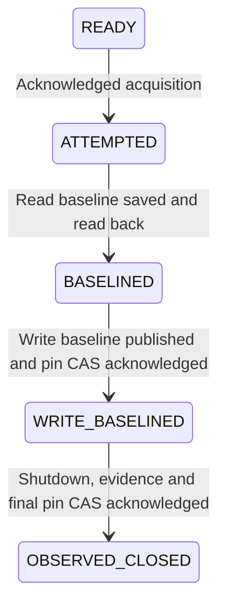

# Durable standard-write evidence in managed maintenance

17 October 2026. Maintenance protocol5 integrates the active synthetic
[write probe](supabase-credential-write-proof.md) and
[exact-version custody](managed-write-evidence.md). It remains an internal
prototype with no public route, scheduler or operator command and no deployment
or real-provider activation implied.

## Static scope and acquired attempts

`ManagedStorageWriteEvidence` validates and copies the static probe registry,
secret records and custody target. Its plan digest includes the registry and
custody location without embedding the maintenance plan itself. The active probe
and evidence store are constructed only after the coordinator has acquired its
exact attempt/plan/source/epoch binding. Both read and write scopes must match
the reviewed storage installation, project, retained control key and modern
secret writer-key cohort. Actual supplied secrets are fingerprint-checked by the
active probe before any of its network operations.

Protocol5 binds the write factory's static digest alongside existing source,
epoch, provider, database, storage and read-proof registries. Protocol1–4 READY
plans refuse before acquisition or dispatch. The independent head stays format1;
readable historical records are not promoted to protocol5 authority.

## Required ordering

1. Acquire the independent one-attempt guard and retain the existing read baseline.
2. Execute the bounded positive synthetic standard-write baseline. Validate its
   actual cohort, payload hashes, source/attempt/epoch/plan and static registry.
3. Publish it conditionally in the evidence store and verify its exact version.
4. CAS that baseline pin into the control head as WRITE_BASELINED. Require exact
   head readback, then re-read and validate the pinned artifact before shutdown.
5. Only the acknowledged caller may suspend/drain services, close/drain database
   writers, invalidate passwords and revoke the reviewed storage key paths.
6. Obtain scoped read and active standard-write refusals. Publish and verify the
   original write report against its original pinned baseline.
7. Read current component metadata again. CAS OBSERVED_CLOSED with the read
   artifact, write baseline/report pins and matching observation digests against
   the WRITE_BASELINED revision.

The control head retains its 8KiB limit and references separate 8KiB baseline /
16KiB report bodies by exact version/SHA/length. Parent tests exercise 50-key
reports and the head bound. A record's hashes and registry label alone are not
enough: the probe's pure validators also compare saved evidence with the actual
configured credential IDs and payloads, without issuing HTTP requests.

## Unknown responses and inspection

Any unknown acquisition, baseline publication, head-pin CAS, component command,
report publication or final CAS response stops the caller. The original attempt
remains consumed. A fresh `close()` cannot retry or compensate from ATTEMPTED,
BASELINED, WRITE_BASELINED or OBSERVED_CLOSED. No automatic epoch reset, takeover,
secret replacement, cleanup or reopening exists.

An artifact may exist without a known pin or without its pin in the head. This
does not permit inventing a lost acknowledgement, guessing a version, backfilling
a completion or proceeding with shutdown. The separate evidence store does not
discover or delete such unreferenced objects.

`inspect()` reads the head, saved exact-version write artifacts, current component
metadata and fresh credential **read** observations, then checks the unchanged
head revision. It never executes an active write baseline, refusal probe or
publication. It reports `recordedStandardWriteRefusalsObserved` separately from
`freshStandardWriteRefusalsObserved=false`; a saved report is not a fresh write
retest. Missing original evidence remains absent, even if an unreferenced object
was written before a lost response. Recorded report digests and actual cohort
must match the head and configured registry.

## Verification and limits

Unit/SDK/HTTP models cover static scope and circular-hash avoidance, cohort and
payload substitution, baseline/report/head ACK loss, concurrent acquisition,
version/pair checks, 50-key bounds, read-only inspection and protocol downgrade
refusal. The isolated TLS PostgreSQL exercise composes the default read/write
factory, provider/storage adapters, custody and control store with a real local
database and synthetic provider/S3 transports. Fixture-only cleanup of synthetic
roles/services after uncertain cases is explicit, outside production inspection.

`standardWriteRefusalsObserved=true` covers the exact tested CREATE/UPDATE/DELETE
requests only. It does not prove signed/resumable/S3 capability revocation,
in-flight drain, retained control-key least privilege, management-writer exclusion
or global quiescence. Broad write-rejection, whole-backend, source-host-fencing,
tenant-authority and reopening claims remain false or unavailable. Successful
verification retains bounded synthetic probe objects; no cleanup is automatic.

Actual provider acceptance, independent IAM/key/retention custody, source-image
provenance, common database/file capture including orphan/pending cleanup,
current preservation/disposal authority, full restoration, repeated maintenance
epochs and physical source-host-off/reopening proof remain within the full goal.
