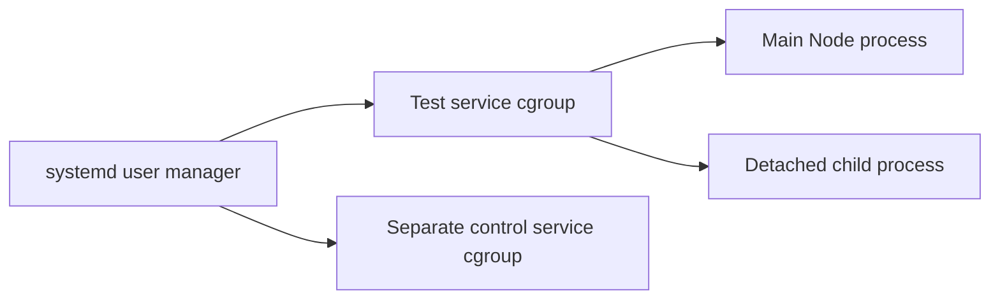

## 17 October: private systemd guardian connection verified

Read [guardian connection](managed-proof-channel.md). The actual guardian and
worker now support a private Unix socket across a systemd launch. Work is withheld
until a fresh manager identity receives an explicit acknowledgement. Real Linux
tests cover success, denied acknowledgement, parent loss and guardian loss while
a separate service survives. The original IPC path remains the current runner
path; original-job custody and production launcher integration are still required.
Full independent-provider/host-loss and delegated product scope remain active.

# Linux user-service kernel containment probe

17 October 2026. A bounded acceptance probe for the next managed source-executor integration. It is not an application deployment, recovery command or proof that the current guardian is already running in a managed cgroup.

## Decision and observed mechanism

The first production managed source executor will require verified kernel process containment. The selected Linux mechanism is a non-root systemd user service on cgroup v2, with control-group termination, no automatic restart and an exact invocation identity. The existing Windows IPC guardian remains useful source/test infrastructure; it is not evidence of Windows kernel containment or complete host-loss recovery. Existing personal-server support and release gates are unchanged.

Systemd documents [control-group termination](https://raw.githubusercontent.com/systemd/systemd/main/man/systemd.kill.xml) and [transient services](https://raw.githubusercontent.com/systemd/systemd/main/man/systemd-run.xml). The probe verifies the behaviour on the selected host rather than treating documentation as runtime evidence.

Both test processes belong to one cgroup even though the child starts a different process group/session. The probe checks actual kernel membership and child process-group/session IDs. It signals only the fresh test unit's current main process through the service manager. After main-process loss, it requires the same invocation, the expected signal result, no main PID and an empty original cgroup. The separate control service and its child must still be running.

## Guarded scope

`node scripts/managed-proof-systemd-containment.mjs --probe` runs only as a non-root Linux user with an existing user manager and cgroup v2. It creates two fresh uniquely named transient services and a private temporary directory. It uses fixed Node fixture code, no network, no application/database/Docker operations and no arbitrary command selector. Each service has a 90-second maximum lifetime, 5-second stop budget, 128 MiB memory cap, 32-task cap, 20% CPU cap, no new privileges and no restart. Actual kernel memory/task/CPU controls and both processes' NoNewPrivs status must match before any success is reported.

Unit identity parsing rejects aliases, a different user hierarchy, path traversal, non-transient/weak termination modes, missing privilege restrictions, malformed invocation/PID/clock data and duplicate properties. Manager-provided identities and current cgroup membership are observations, not saved-PID execution leases. Launch attempts are recorded before invocation so unknown launch acknowledgements still lead to scoped cleanup attempts. Cleanup stops/resets only the exact fresh names; an uncertain cleanup preserves the private request directory and refuses success.

The first probe ran on the existing CharityPilot private VM after canonical repository, operator, architecture, user-manager and resource checks. The module was copied to a protected temporary directory with SHA-256 verification. Application checkout and deployment configuration were not changed. Exact host/module hashes, results and cleanup proof are in the private checkpoint. This neither certifies the private profile for public production nor replaces its installer/update/recovery wrappers.

## Next integration and proof limits

The production runner still needs to place the real guardian/worker/client cohort inside this unit. Its original job descriptor must bind the unit's fresh invocation, release and owner. A service-manager launch needs a private parent-liveness transport; the current inherited Node IPC must not be assumed to pass through systemd. Unknown launch/stop outcomes require inspection without reusing an old execution acknowledgement.

The Docker daemon remains outside the test cgroup: accepted or pending daemon requests, container/volume accounting and source-host fencing remain unproved. This is not hostile-root escape protection, provider IAM, independent storage/key custody, current preservation/disposal authority or whole application host-off recovery/reopening. Those requirements and the full delegated multi-organisation/Confluence goal remain active.
